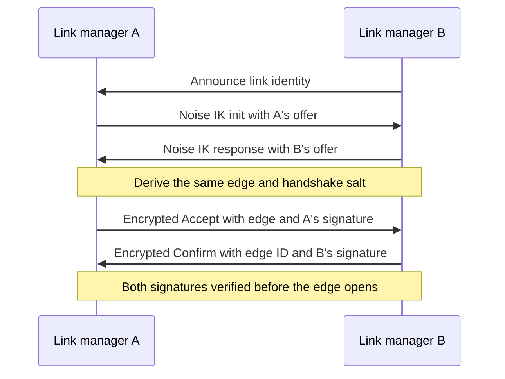
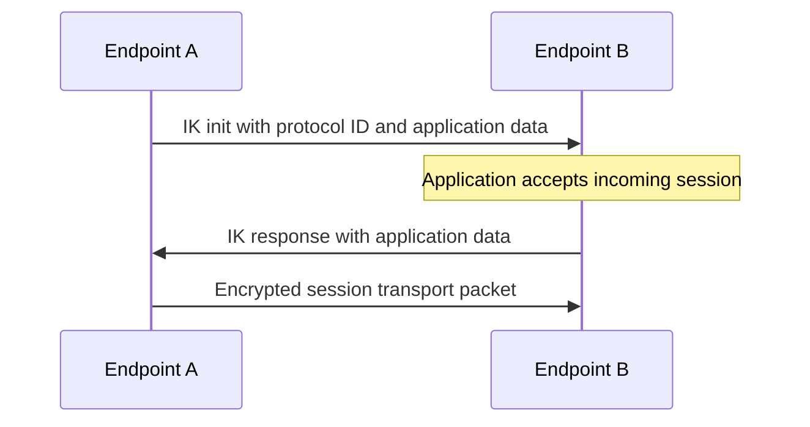

+++
title = "Sandalphon"
description = "Building a distributed mesh routing protocol"
tags = ["programming", "networks"]
section = "posts"
weight = 10

featured = true

[params]
seo_description = "Sandalphon is an encrypted mesh routing protocol using signed edges, path labels, online route discovery, and separate link and endpoint sessions."
related = ["/posts/arp/"]
has_latex = true
has_mermaid = true

[[params.links]]
text = "Source on GitHub"
href = "https://github.com/olimci/sandalphon"
icon = "script_code"
+++

[Sandalphon](https://github.com/olimci/sandalphon) is my attempt at building a simple encrypted mesh routing protocol. The architecture is based vaguely on SCION and MPLS. Made as an experiment, since I found other mesh routing protocols, _cough cough_ ʳᵉᵗᶦᶜᵘˡᵘᵐ _cough cough_, to have a bunch of flaws that I figured I could improve on.

Each peer uses a secp256k1[^1] static private key for identity, signing, and encryption. It then uses this key to mutually sign edges between direct peers.

# Paths, Edges, and Routes

## Edges

At the link layer the protocol tries to negotiate and sign edges between directly adjacent peers; this could be over QUIC, a local socket, or anything. Each link manager has its own ephemeral identity it uses to form Noise sessions, providing safe transport and replay protection on potentially unauthenticated broadcast media.

Edges simply contain two public keys, a 16-byte salt, the edge's MTU, and an expiration time. Once exchanged they are then signed by each party. This provides a self-authenticating grant that two peers are connected. It does not technically enforce that both parties will actually transit packets[^2].

Edges are exchanged by each party transmitting an offer with their public key, reported MTU, and expiry time. Both peers derive the same edge from the two offers:

| Edge field | Derivation |
| --- | --- |
| Public keys | Sorted into a consistent order |
| Salt | Derived from the Noise handshake hash |
| MTU | Smaller of the offered MTUs |
| Expiry | Earlier of the offered expiry times |

Edges have canonical stable IDs, represented as a 16-byte truncated hash of their properties.

The link handshake uses identities generated by the link managers. Noise IK exchanges the offers; then two encrypted follow-up frames exchange signatures made with the peers' static keys. Only after both signatures have been checked does the negotiated edge open:

## Paths

Edges can then be composed to make paths. Paths are a truncated hash chain of edge IDs. For example, say you have a path \\( \text{P0} \\) and you want to extend it with some edge \\( \text{E} \\). You can calculate the extended path \\( \text{P1} \\) as:

\\[ \text{P1} \leftarrow H( \text{E} || \text{P0} ) \\]

...or in the base case...

\\[ \text{P0} \leftarrow H( \text{E} || 0 ) \\]

These, unlike edges, are not self-verifying, so you must know and verify every edge in a path to trust it. Path validation checks that the edges connect in order and that no peer is visited twice[^3].

This gives you a way to create a constant-size label for any path through the network, which will be useful later.

## Routes

Routes are paths indexed by destination. A peer can request routes to a destination from its neighbours; each neighbour replies with up to \\( K \\) eligible paths. A newly opened edge also gives each endpoint a direct route to the other.

The "best" route for any peer is the shortest valid path to the destination. If several valid paths have the same number of edges, the largest bottleneck MTU wins, then the latest expiry, then the lowest path ID.

Later choices try to reduce edge overlap across routes. For every edge, the router tracks how many already selected routes use it. It chooses the candidate that would leave the lowest maximum edge load, then the least total overlap; remaining ties are broken by edge count, bottleneck MTU, expiry, and path ID.

When advertising to a neighbour, the router excludes paths that would immediately send traffic back over the ingress edge, as well as paths blocked by transit-group rules. When sending a packet, it selects the first ranked route whose MTU can carry it.

# Forwarding Datagrams

Datagrams are simply a 16-byte path ID (the header) followed by an arbitrarily long body. The router stores a reverse cache of edge compositions, or more specifically a table mapping some extended path to the component extending edge and original path. For simplicity we will consider this as a function:

\\[ \text{next} : ( \text{P1} ) \mapsto ( \text{E}, \text{P0} ) \\]

When forwarding a packet, the router reads the inbound header, looks up \\( \text{next} (\text{P1}) \\), which gives it an egress edge \\( \text{E} \\) and the next header \\( \text{P0} \\).

For example, say you (\\( \text{A} \\)) want to send a packet to \\( \text{E} \\). You first have to have learnt a route for \\( \text{E} \\). In this case we will consider the route made of edges \\( \text{AB-BC-CD-DE} \\), or in short \\( \text{AE} \\). To make the packet header, you look up \\( \text{next}(\text{AE}) \\), giving you the egress edge \\( \text{AB} \\) and the next path \\( \text{BE} \\). You write \\( \text{BE} \\) to the packet's header and forward on your local edge \\( \text{AB} \\)[^4].

When \\( \text{B} \\) receives your packet, it looks up \\( \text{next}(\text{BE}) \\), returning \\( (\text{BC}, \text{CE}) \\). It rewrites the packet header to \\( \text{CE} \\) and sends on \\( \text{BC} \\). This continues until \\( \text{D} \\) receives the packet. \\( \text{next}(\text{DE}) \\) is \\( (\text{DE}, 0) \\), so the packet header is set to \\( 0 \\) and sent through edge \\( \text{DE} \\). On receiving a packet addressed at \\( 0 \\), \\( \text{E} \\) knows it must be addressed to itself, so it accepts the packet.

This routing header design gives you effectively constant header size across arbitrary-length paths, without needing to first prime the connection or preventing path-addressing. As a downside, it means you must send your packet along paths that have been directly gossiped to you, so you could assemble some path out of edges you are locally aware of, but there is no guarantee that remote peers will have knowledge of it and be able to forward it.

# Encryption

There are two separate kinds of Noise session[^5]. Adjacent peers encrypt each link's frames, including route gossip and datagrams. The communicating endpoints use another Noise IK handshake with their static peer identities to establish a session across the routed network. This one carries a protocol ID and application data in its first message, and the destination application must accept before replying. Routing is transparent to this endpoint handshake.

The endpoint session is tied to the peer rather than a particular path, so a route change need not end the conversation.

# Summary

Overall, it gives you online routing, (limited) path-addressability, some relatively good guarantees[^6] for being able to reach remote peers even on networks with malicious actors. The path-label-switching header gives you fixed packet header sizes over arbitrarily long paths too, which is nice.

Main goals of the project are:

- Providing better routing guarantees than other mesh networking protocols
- Providing good cross-layer separability, for the sake of making the protocol easier to implement and more auditable
- Making implementation compatibility depend entirely on logical correctness, not requiring that implementations match every timing parameter, for example.

Currently it does not attempt to solve:

- Initiator anonymity[^7]
- Performance in extremely low-MTU environments (such as BLE, LoRa)

Future work includes:

- Embassy runtimes
- A network daemon, and some example higher-layer protocols.
- I want to include some form of network tomography. This would partially address the issue described in [^2].

The project is still very much WIP.

[^1]: I decided on this, since it allows me to reuse the same key for signing and encryption. Other protocols use a pair of ed25519 and x25519 keys, which doubles the byte-overhead of each key which I wanted to avoid. You can directly translate ed25519 curves to x25519 curves, but that is more effort than just using one key. Also secp256k1 is cool.

[^2]: This is a characteristic issue in networking, where two parties collude out-of-band to offer paths that might not actually exist, or appear shorter than they actually are. The scope of this is somewhat bounded by network topology fortunately, and is a relatively unsolvable problem, without actively probing the network.

[^3]: The path ID alone does not prove that its edges form a usable route. The receiver reconstructs the path and checks each edge against the current peer; it also rejects repeated peers.

[^4]: You would have heard this path gossiped from \\( \text{B} \\) in order to send packets with it, so \\( \text{B} \\) must be aware of the path.

[^5]: Specifically `Noise_IK_secp256k1_ChaCha20Poly1305_SHA256`. I say "custom" here since secp256k1 is not advertised as a standard implementation of Noise; however, the ECDH primitives are exactly the same as using 25519, for example, so there is no reason why this should be an issue, besides that secp256k1 hasn't been vetted for use with Noise.

[^6]: SCION's guarantee is effectively "you can reach any peer on the network assuming there exists a path without a malicious node." Sandalphon behaves similarly, but since we cannot really make each node aware of the entire network topology, this guarantee is provided on a best-effort basis. The level of awareness can be individually tuned by setting the \\( K \\) parameter, at the expense of network congestion from control-plane traffic; practically, the routing guarantee approaches the SCION one as \\( K \to \infty \\).

[^7]: As described in [6], the network's robustness to malicious actors is related to the awareness that each node has of the entire network topology; therefore, providing initiator anonymity somewhat goes against resilient routing. In practice, I'm not sure initiator anonymity is that useful, however; it might be good enough to just rotate your node's private key regularly as an alternative.
